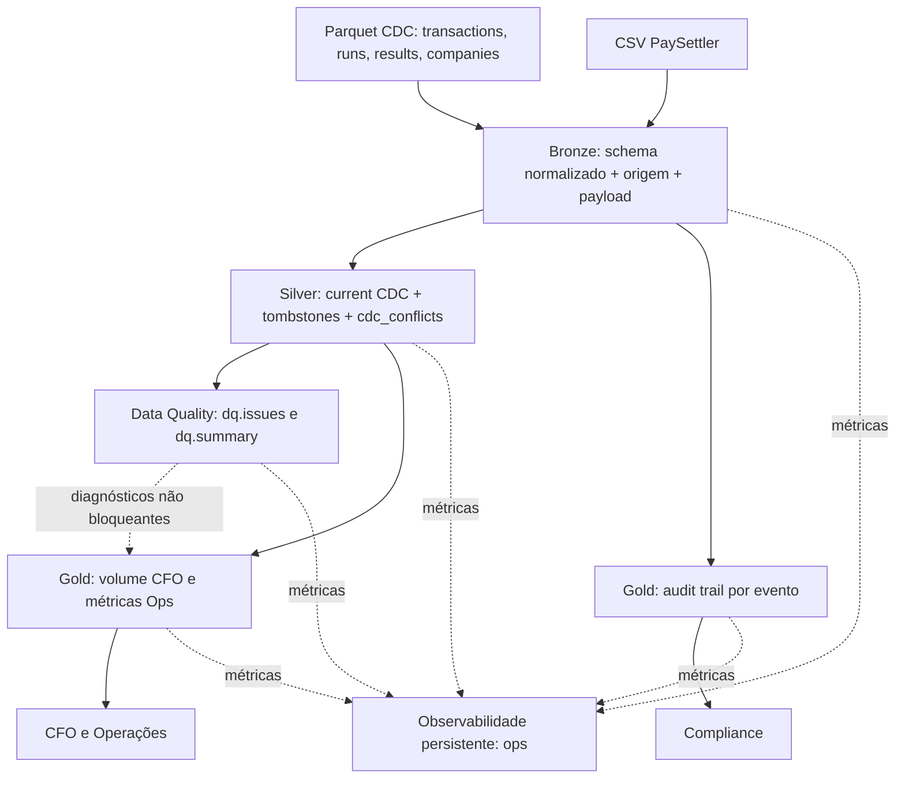

# Case Técnico — Engenheiro(a) de Dados Sênior / Especialista
## Contexto de Negócio

Você está entrando no time de dados de uma fintech que processa liquidações de pagamentos para merchants. A empresa opera o **Settlement Reconciliation Service** — um serviço em produção que:
1. Recebe diariamente um **arquivo CSV** do processador de pagamentos externo (**PaySettler**) com as transações liquidadas nas últimas 24h
2. Compara essas transações com os **registros internos** do sistema
3. Categoriza cada transação e persiste os resultados em um **PostgreSQL** (`settlement_db`)
O serviço funciona bem, mas **todos os dados vivem apenas no banco transacional**. O time de operações precisa saber se a taxa de discrepância está subindo. O CFO quer o volume transacionado por dia. Compliance precisa de histórico de auditoria. **Ninguém tem acesso estruturado a nada disso hoje.**
### Sua Missão

Construir uma solução que transforme esses dados em **produtos de dados** consumíveis pelo negócio. Cabe a você decidir como.

---

## Domínio: Reconciliação de Liquidações

> O glossário completo está em [`docs/domain-glossary.md`](docs/domain-glossary.md). Leia antes de começar.
### Tabelas Fonte (`settlement_db`)

**`transactions`** — Transações internas do sistema
| Coluna | Tipo | Descrição |
|--------|------|-----------|
| `id` | bigint | PK |
| `transaction_id` | uuid | Identificador único da transação |
| `merchant_id` | varchar | Identificador do merchant |
| `amount` | decimal | Valor da transação (BRL) |
| `currency` | varchar | Moeda (ISO 4217) |
| `status` | varchar | `COMPLETED`, `PENDING`, `FAILED` |
| `description` | varchar | Descrição da transação |
| `created_at` | timestamp | Data de criação |
| `updated_at` | timestamp | Última atualização |
**`reconciliation_runs`** — Execuções de reconciliação
| Coluna | Tipo | Descrição |
|--------|------|-----------|
| `id` | bigint | PK |
| `reference_date` | date | Data de referência do arquivo (dia de negócio) |
| `file_name` | varchar | Nome do arquivo processado |
| `status` | varchar | `IN_PROGRESS`, `COMPLETED`, `FAILED` |
| `total_transactions` | integer | Total de transações no arquivo |
| `started_at` | timestamp | Início do processamento |
| `completed_at` | timestamp | Fim do processamento |
| `created_at` | timestamp | Data de criação do registro |
**`reconciliation_results`** — Resultados da reconciliação
| Coluna | Tipo | Descrição |
|--------|------|-----------|
| `id` | bigint | PK |
| `run_id` | bigint | FK → `reconciliation_runs.id` |
| `transaction_id` | uuid | Identificador da transação |
| `merchant_id` | varchar | Identificador do merchant |
| `category` | varchar | `MATCHED`, `MISMATCHED`, `UNRECONCILED_PROCESSOR`, `UNRECONCILED_INTERNAL` |
| `internal_amount` | decimal | Valor no sistema interno (null se unreconciled_processor) |
| `processor_amount` | decimal | Valor no PaySettler (null se unreconciled_internal) |
| `difference` | decimal | Diferença absoluta entre valores |
| `created_at` | timestamp | Data de criação |
**`enterprise_company`** — Dados cadastrais dos merchants

| Coluna | Tipo | Descrição |
|--------|------|-----------|
| `id` | bigint | PK |
| `merchant_id` | varchar | Código do merchant |
| `legal_name` | varchar | Razão social |
| `trade_name` | varchar | Nome fantasia |
| `document` | varchar | CNPJ |
| `primary_cnae` | varchar | CNAE principal |
| `created_at` | timestamp | Data de criação |
| `updated_at` | timestamp | Última atualização |
### Arquivo CSV do PaySettler

O processador externo envia diariamente um CSV com as transações liquidadas.
| Coluna | Tipo | Descrição |
|--------|------|-----------|
| `transaction_id` | uuid | Identificador da transação |
| `merchant_id` | varchar | Identificador do merchant |
| `amount` | decimal | Valor liquidado |
| `currency` | varchar | Moeda (ISO 4217) |
| `settled_at` | datetime (ISO 8601, UTC) | Data/hora da liquidação |
| `processor_reference` | varchar | Referência interna do processador |
| `status` | varchar | `SETTLED` ou `REVERSED` |

---
## Stack

- **Linguagem:** Python 3.12+
- **Processamento:** DuckDB
- **Conteinerização:** Docker + Docker Compose
- **Armazenamento:** Filesystem local

A solução deve **rodar localmente** com `docker-compose up`.

---
## Dados de Exemplo

Na pasta `docs/sample-data/` você encontrará:

- `transactions_batch_1.parquet` — Transações internas (lote 1)
- `transactions_batch_2.parquet` — Transações internas (lote 2)
- `reconciliation_runs.parquet` — Execuções de reconciliação
- `reconciliation_results.parquet` — Resultados categorizados
- `settlement_paysettler.csv` — Arquivo CSV do PaySettler
- `enterprise_company.parquet` — Dados cadastrais de merchants

---
## Como Começar

1. **Faça um fork** deste repositório para sua conta pessoal do GitHub
2. Clone o seu fork e trabalhe nele normalmente
3. Suba o ambiente:

```bash
docker compose up -d --build
# ou: make up
```

Um `Makefile` no repositório expõe atalhos para as operações mais comuns (`make help` lista os alvos disponíveis). O uso é opcional.

---

## Requisitos
### Parte 1 — Modelagem e Analytics

Usando os dados disponíveis, **modele e implemente tabelas analíticas** que atendam os seguintes consumidores:

- **Operações:** precisa acompanhar a saúde das reconciliações no dia a dia
- **CFO:** precisa de visão consolidada do volume financeiro
- **Compliance:** precisa de rastreabilidade e histórico para auditorias
**A forma e o conteúdo das tabelas são decisão sua.** Traduza as dores acima em métricas e tabelas analíticas (fatos e dimensões) que você defenderia em produção. Documente, para cada consumidor:

- **Quais perguntas** seu modelo consegue responder (e quais deliberadamente não)
- **Por que** essas e não outras (priorização, tradeoffs de escopo vs tempo)
Entregue também exemplos de queries rodando contra suas tabelas que respondem as perguntas que você propôs. Queremos ver seu raciocínio de produto, não só SQL.

---
### Parte 2 — Pipeline de Dados

Implemente o pipeline que processa as fontes de dados disponíveis e prepara o insumo para as tabelas analíticas da Parte 1.

O volume em `docs/sample-data/` é pequeno de propósito — assuma **~5M transações/mês em produção** e projete para crescer. Se quiser validar na prática como seu pipeline se comporta em escala, use o gerador descrito na seção _"Dados de Exemplo e Geração de Volume"_.
Critérios de qualidade (como você os atende é decisão sua — documente suas escolhas):
- **Correção:** a saída do pipeline bate com o contrato de dados que você propôs
- **Idempotência:** executar o pipeline para a mesma data de referência duas vezes não pode duplicar registros nem corromper as tabelas. Considere como isso se manifesta na sua CLI, nas tabelas finais e em falhas no meio da execução
- **Observabilidade:** em produção, quando algo quebrar, que sinais você precisaria para diagnosticar rapidamente?
- **Qualidade de dados:** quais checks você adicionaria para proteger os consumidores de downstream de dados incorretos? O que faria o pipeline parar versus apenas alertar?
- **Testabilidade:** como você valida automaticamente que uma mudança no código não quebra o comportamento?
Stack obrigatória: **DuckDB** para processamento, **Python 3.12+**, **Docker Compose** para subir o ambiente.

---
### Parte 3 — Arquitetura

#### 3.1 Desenho de Arquitetura

**Explique e/ou desenhe** como você levaria esses dados do banco transacional até o consumo pelo negócio em produção.

#### 3.2 Troubleshooting

Segunda-feira de manhã. Ops abre um chamado: os dashboards de reconciliação estão sem dados desde sexta-feira à noite. Você é o primeiro a chegar.

Como você investigaria? Que artefatos do próprio pipeline você consultaria? Até onde iria antes de acionar mais alguém?
#### 3.3 Escalabilidade

Hoje o volume é pequeno, mas o negócio projeta chegar em **~5M transações/dia** em 18 meses (≈1,8B/ano em `reconciliation_results`). Como você prepararia a plataforma para esse crescimento? Onde o desenho atual quebra primeiro?

---

## Dados de Exemplo e Geração de Volume

O repositório oferece duas fontes de dado. **A escolha de volume e de quais fontes usar é sua.**
### 1. Fixture pequeno — `docs/sample-data/`

Cerca de 1.000 transações internas e ~500 liquidações. Pensado para exploração, desenvolvimento local e como insumo default dos exemplos de queries da Parte 1.
### 2. Gerador sintético — `scripts/generate_sample_data.py`

Produz o mesmo schema do fixture (CDC `Op`/`_timestamp`, schema drift entre batches, padrões realistas de dados sujos) em volume arbitrário. Útil para validar seu pipeline em escala — por exemplo, ao redor dos ~5M transações/mês assumidos na Parte 2.

**Você define o volume e as características.** O script é parametrizável:
```bash
# dataset médio para smoke em escala (1M transações, 90 dias)
python scripts/generate_sample_data.py --rows 1000000 --days 90 --out /tmp/medium
# dataset alinhado à projeção de ~5M transações/mês
python scripts/generate_sample_data.py --rows 5000000 --days 30 --out /tmp/month
```

Flags principais:

| Flag | Descrição | Default |
|------|-----------|---------|
| `--rows N` | Total de transações internas a gerar | `1000000` |
| `--days N` | Janela temporal em dias | `90` |
| `--merchants N` | Número de merchants | `500` |
| `--seed N` | Semente determinística | `42` |
| `--out PATH` | Diretório de saída | `docs/sample-data` |
Rode `python scripts/generate_sample_data.py --help` para a lista completa. Dentro do container, `make generate` (10k linhas) e `make generate-large` (1M linhas) são atalhos prontos.

---
## Uso de IA

Fique à vontade para usar ferramentas de IA durante o desafio. Se usar, documente no item _"Ferramentas de IA utilizadas"_ da entrega quais ferramentas e para quê. Se mantiver prompts, configs (`CLAUDE.md`, `.cursorrules`, etc.) ou transcrições no repositório, melhor — ajuda a entender seu processo.

---

## Entrega

## Implementação entregue — guia de avaliação

> **Orientação de leitura:** o enunciado original, incluindo fontes, requisitos, regras e instruções de entrega, foi preservado neste arquivo. Abaixo está o índice da solução implementada; os detalhes técnicos e comandos estão na seção [Solução desenvolvida](#solução-desenvolvida--settlement-analytics), ao final.

| Requisito | Evidência na implementação |
|---|---|
| **Parte 1 — Modelagem e Analytics** | `gold.daily_financial_volume` (CFO), `gold.daily_reconciliation_metrics` (Operações), `gold.reconciliation_audit_trail` (Compliance), contratos Gold e consultas analíticas de exemplo. |
| **Parte 2 — Pipeline** | Bronze Parquet/CSV, Silver CDC I/U/D com quarentena de empates, Data Quality (`dq.issues`), CLI, testes e idempotência lógica verificada. |
| **Observabilidade** | Histórico de runs, etapas, duração, erros e métricas em `ops.pipeline_runs`, `ops.pipeline_steps` e `ops.pipeline_metrics`. |
| **Parte 3 — Arquitetura** | Diagrama Mermaid, plano de troubleshooting, análise de gargalos e estratégia documentada para crescimento a 5 milhões/dia. |
| **Extensibilidade** | Mudanças necessárias para adicionar um segundo processador estimadas por módulo, testes e configuração futura. |
| **Validação prática** | 22 testes aprovados no conjunto inicialmente validado; benchmark sintético de referência de 1 milhão: 76,68 s somados nas quatro etapas. |

**Limites declarados:** o desenho executa *full refresh*, não processamento incremental; a conferência automatizada de idempotência não compara hashes Gold; falhas entre etapas não formam uma transação única entre todas as camadas; não há reconciliação financeira independente do serviço de origem. Essas decisões e possíveis evoluções estão documentadas abaixo.

---

1. Ao finalizar, **abra um Pull Request do seu fork para o repositório original** (branch `main`)
2. Preencha as seções abaixo no README do seu PR:
### Como rodar

_Descreva os passos para rodar a aplicação._

### Premissas e decisões

_Documente as ambiguidades que encontrou e as decisões que tomou._

### Visão geral da arquitetura

_Descreva a estrutura do projeto. Diagrama é bem-vindo._
### Extensibilidade

_Se amanhã precisarmos plugar uma **segunda fonte de liquidação** (ex.: outro processador além do PaySettler, com schema parecido mas não idêntico), **quantos arquivos/linhas mudam** no seu projeto? Descreva o caminho concreto — quais módulos tocam, qual config precisa ser estendida, quais testes rodam de novo._
### Limites do desenho

_O que a sua arquitetura **deliberadamente não suporta hoje** e que você sabe que uma versão de produção precisaria? Dê **2 a 3 exemplos concretos** (evite "melhorar logs" ou "mais testes" — seja específico)._

### O que faria diferente em produção

_O que simplificou? O que a versão de produção precisaria?_

### Ferramentas de IA utilizadas

_Quais ferramentas de IA usou e para quê? Encorajamos o uso de IA — queremos entender como você a utiliza como ferramenta de trabalho._

---
## Prazo

Você tem **3 a 4 dias** para completar o desafio.

Valorizamos uma solução **completa, limpa e bem documentada** mais do que rica em features. Se o tempo estiver curto, reduza escopo, não qualidade.

---
## Observações

- **Não inclua código malicioso no projeto.** Caso identificado, o projeto será desconsiderado.
- Após a entrega, faremos uma **conversa técnica de ~45 minutos** sobre sua implementação e decisões.

*Boa sorte! Qualquer dúvida sobre o enunciado, entre em contato antes de assumir premissas.*


---

## Solução desenvolvida — Settlement Analytics

Pipeline local em **Python 3.12+, DuckDB e Docker Compose** que transforma dados de transações, reconciliações, merchants e arquivos PaySettler em três produtos analíticos. Implementação orientada ao case de [reconciliação de liquidações](https://github.com/marvincomvc/data-engineer-challenge) e ao [glossário](https://github.com/marvincomvc/data-engineer-challenge/blob/main/docs/domain-glossary.md).

## Como rodar

### Pré-requisitos

- Docker e Docker Compose.
- Os arquivos originais em `docs/sample-data/` (dois batches de transações em Parquet, runs, results, cadastro e CSV `settlement*.csv`).
- `docker-compose.yml` com o serviço `pipeline` e os bind mounts `./scripts:/app/scripts`, `./docs/sample-data:/app/docs/sample-data:ro`, `./tests:/app/tests` e **`./data:/app/data`**. Configure os mounts adicionais já existentes sem removê-los.
- A imagem deve instalar as dependências do `pyproject.toml`, incluindo `duckdb`, `pytest` e `pytz` (necessário para leitura Python de `TIMESTAMPTZ` no verificador de idempotência). Se `pytz` ainda não estiver declarado, adicione-o às dependências antes do build.

```bash
mkdir -p data
docker compose up -d --build
docker compose ps
```

> O volume `./data:/app/data` persiste `data/marvin.duckdb` fora do container. Feche conexões de escrita da DuckDB UI/CLI antes de executar os pipelines para evitar locks.

### Pipeline completo

```bash
docker compose exec pipeline python scripts/run_pipeline.py \
  --input-dir /app/docs/sample-data \
  --db /app/data/marvin.duckdb \
  --with-gold \
  --gold-script scripts/gold.py
```

A execução materializa **Bronze → Silver → Data Quality → Gold**. Para apenas as três primeiras etapas, omita `--with-gold --gold-script scripts/gold.py`.

### Testes e idempotência

```bash
docker compose exec pipeline python -m pytest tests/ -v

docker compose exec pipeline python scripts/run_pipeline.py \
  --input-dir /app/docs/sample-data \
  --db /app/data/marvin.duckdb \
  --with-gold \
  --gold-script scripts/gold.py \
  --verify-idempotency
```

**Validação realizada em 12/10/2026:** 22 testes passaram; pipeline executado duas vezes com resultado `Idempotência OK: conteúdo lógico idêntico após reprocessamento`. A comparação automática de snapshots do CLI cobre tabelas **Bronze, Silver e `dq.issues`** (e contagem da view PaySettler); **não calcula hashes das tabelas Gold**. A Gold tem testes próprios de repetibilidade.

### Consultas úteis

```sql
SELECT * FROM gold.daily_financial_volume ORDER BY transaction_date, currency;
SELECT * FROM gold.daily_reconciliation_metrics ORDER BY reference_date;
SELECT * FROM gold.reconciliation_audit_trail LIMIT 20;
SELECT * FROM dq.summary ORDER BY issue_count DESC;
SELECT * FROM silver.cdc_conflicts ORDER BY source_table, business_key;
```

A UI do DuckDB é opcional (CLI: `duckdb /app/data/marvin.duckdb`, seguida de `LOAD ui; CALL start_ui_server();`, se a extensão estiver instalada). Se o Compose estiver configurado com `network_mode: host` e Docker Desktop suportar host networking, a UI ficará em `http://localhost:4213`. Uma conexão CLI/UI que mantenha o banco aberto para escrita pode impedir a execução Python simultânea.

### Resultado observado com o fixture original

| Componente | Registros / ocorrências |
|---|---:|
| `bronze.transactions` | 1.060 eventos |
| `bronze.reconciliation_runs` | 19 eventos |
| `bronze.reconciliation_results` | 837 eventos |
| `bronze.enterprise_company` | 70 eventos |
| `bronze.paysettler` | 510 linhas |
| `silver.transactions_current` | 992 ativos; 4 exclusões; 4 chaves ambíguas |
| `gold.daily_financial_volume` | 30 linhas |
| `gold.daily_reconciliation_metrics` | 9 linhas |
| `gold.reconciliation_audit_trail` | 837 eventos |

As contagens são evidências de uma execução local; não são valores contratuais para outros dados de entrada.

## Premissas e decisões

- **Bronze é imutável logicamente, não fisicamente append-only:** relê e substitui as tabelas em transação; preserva eventos `I/U/D`, payload original, origem do arquivo e timestamp de ingestão. Normalizações utilizam `TRY_CAST`; erros de conversão não devem ser interpretados como correções bem-sucedidas.
- **Silver representa o estado atual**, com `ROW_NUMBER()` por chave (`transaction_id` em transações; `id` nas outras fontes CDC), maior `_timestamp`, tombstones removidos. Empates no último timestamp com payloads distintos são excluídos da visão current e registrados em `silver.cdc_conflicts` — inclusive casos potencialmente equivalentes `I/U`.
- **PaySettler é um fluxo CSV sem envelope CDC:** `silver.paysettler_events` expõe o conteúdo Bronze sem inferir exclusões ou substituições.
- **Data Quality não altera fatos:** guarda divergências em `dq.issues` e agregações em `dq.summary`, com severidades diagnósticas. Problemas HIGH **não bloqueiam automaticamente** a Gold nesta versão.
- **Reconciliação:** as categorias vêm do serviço fonte, com tolerância de **R$ 0,01**, chave `transaction_id` e janela de datas `[reference_date - 7 dias, reference_date]` (UTC). As validações contra `transactions_current` são diagnósticos no **estado atual**, não provas de erro no snapshot histórico de cada run.
- **Anomalia comprovada na amostra:** a execução DQ identificou 808 ocorrências de `MERCHANT_MISMATCH`, 804 de `INTERNAL_AMOUNT_MISMATCH`, 601 de `TRANSACTION_OUTSIDE_WINDOW`, 5 de `RECON_DIFFERENCE_INCORRECT`, 5 de `RECON_RUN_MISSING`, 5 de `TRANSACTION_MISSING` e 4 chaves `CDC_AMBIGUOUS_LATEST`. Ocorrências podem se sobrepor; não somar como total de transações defeituosas. Um teste com dados regenerados (`--rows 10000 --days 30 --merchants 100 --seed 42 --clean`) produziu 9.479 matches completos, 521 ausências internas e 0 divergências de merchant/valor nos registros com match. Isto sugere diferenças entre os fixtures fornecidos e o comportamento do gerador, **sem provar a causa**.
- **CFO:** contabiliza somente transações internas `COMPLETED`, ativas e não ambíguas, agrupadas por **data UTC de criação + moeda**. Não significa volume efetivamente liquidado, caixa, receita líquida nem fotografia histórica “as-of”.
- **Operações:** usa a última execução `COMPLETED` por `reference_date` (`completed_at`, `started_at`, `id` decrescente) e publica métricas **reportadas**, não recomputadas contra transações internas.
- **Compliance:** conserva cada evento CDC de `bronze.reconciliation_results` enriquecido com o **estado atual** do run; não é reconstrução histórica completa de todos os campos do run.

- **Escopo do full refresh:** todas as fontes são relidas a cada execução; a idempotência demonstrada exige um conjunto completo e estável de entradas. Ingestão incremental, offset/LSN, backfills e atualizações por partição são propostas de evolução, não funcionalidades já implementadas.
- **Escopo da reconciliação:** os resultados de conciliação são provenientes do serviço fonte. O pipeline não reexecuta independentemente o algoritmo financeiro sobre os históricos de cada arquivo/run. As discrepâncias dos fixtures originais são diagnósticos e não permitem, isoladamente, concluir que o resultado histórico reportado está errado.

Mais detalhes: [Decisões arquiteturais](docs/ARCHITECTURE_DECISIONS.md) e [contratos Gold](docs/GOLD_CONTRACT_REVIEW.md).

## Visão geral da arquitetura



**Organização principal:**

```text
scripts/bronze_ingest.py      # ingestão e normalização
scripts/silver_cdc.py         # CDC e quarentena de empate
scripts/data_quality.py      # regras de consistência e issues
scripts/gold.py              # três produtos Gold
scripts/run_pipeline.py      # CLI, idempotência e observabilidade
scripts/pipeline_observability.py # histórico persistente de execuções e métricas
tests/                       # 22 testes aprovados no ambiente validado
docs/sample-data/            # entradas originais, preservadas
docs/ARCHITECTURE_DECISIONS.md
docs/GOLD_CONTRACT_REVIEW.md
docs/OBSERVABILITY.md
docs/SCALABILITY_PLAN.md
docs/GOLD_ANALYTICAL_QUERIES.md
data/marvin.duckdb            # gerado localmente, não versionado
```

## Extensibilidade

**Segundo processador de liquidação com schema semelhante mas não idêntico: hoje não é plug-and-play.** O mapeamento de fontes e schemas está embutido no código, não em um catálogo declarativo. Caminho concreto para um novo `OtherSettler`:

1. Adicionar fixture CSV de teste em diretório controlado, sem misturá-lo com `settlement*.csv` do PaySettler.
2. Alterar `scripts/bronze_ingest.py`: estender `input_files()` para localizar a nova fonte e `SCHEMAS`/normalização para campos específicos (por exemplo `paid_value`, `processed_at`, `external_id`). Criar `bronze.othersettler` separado; **não** carregar registros de processadores diferentes no mesmo schema sem `processor_name`.
3. Alterar `scripts/silver_cdc.py`: criar `silver.othersettler_events` (ou generalizar um modelo de eventos com `processor_name`), mantendo sem CDC caso a nova fonte também seja snapshot/CSV sem `Op`.
4. Alterar `scripts/run_pipeline.py`: registrar a nova tabela nas listas de snapshot e no relatório de execução; generalizar `scripts/data_quality.py` com checks de campo obrigatório, duplicidade por processador/referência e integridade. Alterar `scripts/gold.py` **somente se** novos produtos passarem a consumir eventos externos — os três produtos atuais não fazem essa soma.
5. Estender `tests/test_bronze_ingest.py`, `tests/test_silver_cdc.py`, `tests/test_data_quality.py` e testes de integração; atualizar os contratos e exemplos.

**Impacto estimado na implementação atual:** pelo menos **3 arquivos Python** para ingestão/visibilidade no pipeline (`bronze_ingest.py`, `silver_cdc.py`, `run_pipeline.py`), **4 se incluirmos Data Quality**; mais **2–4 arquivos de teste/documentação**, conforme escopo. Ordem de grandeza: **~60–150 linhas de código/fixture/testes** para um adaptador simples. Isso é **estimativa**, não contagem medida. Se for exigido um modelo de liquidação unificado, o impacto é maior e incluirá a Gold. Uma versão mais extensível teria `config/processors.yml` com padrões de arquivos, colunas de origem, mapeamentos canônicos, timezone e regras de chave; **essa configuração ainda não existe**.

Rodar novamente: `pytest tests/ -v`, a CLI end-to-end e `--verify-idempotency`, mais testes de contract/schema drift e isolamento por processador. Validar que o PaySettler original não mudou.

## Limites do desenho

1. **Full refresh local:** Bronze/Silver/Gold recriam tabelas; não há ingestão incremental por offsets/checkpoints, particionamento persistente nem execução de backfill por `reference_date`. Em volumes da ordem de 5M/dia o custo e a janela de processamento deixam de ser previsíveis.
2. **CDC sem ordem total:** `_timestamp` sozinho não resolve atualizações concorrentes com timestamps iguais; chaves empatadas são quarentenadas. Produção exigiria LSN/sequence de origem, snapshot consistente e regras de resolução auditáveis.
3. **Auditoria histórica e governança incompletas:** `gold.reconciliation_audit_trail` contém histórico de eventos dos resultados, mas dados do run vêm do estado atual; não há trilha “as-of” imutável por execução nem controle de acesso/retention legal formalizado. Também não há gate automático impedindo publicação de métricas de origem pouco confiável.

## O que faria diferente em produção

Este case simplifica deliberadamente o ambiente: arquivos locais no lugar de CDC/ingestão incremental de PostgreSQL; DuckDB embedded em arquivo único; snapshots transacionais; execução CLI manual; sem infraestrutura de scheduler, alertas ou controle de acesso por consumidor.

Para produção eu adicionaria **extração CDC com offset/LSN e armazenamento versionado** (Parquet/Delta/Iceberg com idempotência por lote), **processamento incremental por partição/`reference_date` e política de backfill**, **contratos por processador com isolamento e `processor_name` obrigatório**, e **gates de DQ** (por exemplo, bloquear publicação financeira se a taxa de merchant mismatch exceder limiar acordado). Orquestração com retries, métricas de frescor/latência e rastreamento por `run_id`, além de RBAC e auditoria imutável para Compliance. Para a projeção de ~5M transações/dia, faria benchmark de memória/latência e avaliaria engine/armazenamento distribuído antes de ampliar o desenho local.

**Troubleshooting (dashboards sem dados desde sexta-feira):** consultar `ops.pipeline_runs` e `ops.pipeline_steps` para localizar a última execução, etapa e mensagem de erro; verificar disponibilidade e horários dos arquivos, status do container e logs da CLI, frescor das tabelas Bronze/Silver/Gold, última `reference_date` publicada, `dq.summary`, contagem por fonte/run e presença de locks/erros de commit. Comparar números da fonte com Bronze e Silver para localizar a perda. Acionar equipe dona da fonte se faltar arquivo/CDC; plataforma se houver falha de infraestrutura; time de reconciliação se houver categorias ou runs inesperados.

## Ferramentas de IA utilizadas

**ChatGPT (OpenAI):** apoio na discussão de arquitetura Bronze/Silver/Gold, desenho e geração inicial de scripts Python/SQL, testes, documentação, investigação de CDC ambíguo, resolução de dependências Docker/DuckDB e interpretação de relatórios de qualidade. O uso foi iterativo, com feedback de execuções reais e correções quando os primeiros scripts falharam (ex.: `TRIM(DOUBLE)`, conflitos CDC e dependência `pytz`).

**Validação humana:** inspeção dos dados e do glossário, execução dos scripts e dos 22 testes, confirmação de idempotência em Docker e decisões finais sobre limitações e resultados. Código sugerido por IA deve ser revisado antes do PR; os resultados descritos acima vieram das execuções locais, não apenas de suposições do assistente.

### Escalabilidade

A implementação atual utiliza processamento batch com full refresh,
adequado ao escopo do desafio técnico.

Para suportar aproximadamente 5 milhões de transações por dia,
foi elaborado um plano de evolução contemplando ingestão incremental,
CDC, particionamento, processamento seletivo e escalabilidade horizontal.

Consulte [Plano de Escalabilidade](docs/SCALABILITY_PLAN.md).

## Benchmark de desempenho — dados sintéticos

Teste local executado com o gerador `scripts/generate_sample_data.py` usando `--rows 1000000`. O número de **1 milhão** é o parâmetro do gerador, não a contagem de linhas de todas as fontes (há registros CDC, PaySettler e resultados de reconciliação em quantidades distintas).

| Etapa | Tempo observado | Status |
|---|---:|---|
| Bronze | 41,70 s | SUCCESS |
| Silver | 27,09 s | SUCCESS |
| Data Quality | 2,05 s | SUCCESS |
| Gold | 5,84 s | SUCCESS |
| **Soma das etapas** | **76,68 s** | **SUCCESS** |

A observabilidade registrou cerca de **54,4%** do tempo em Bronze e **35,3%** em Silver. Os **76,68 s** são a soma de durações das etapas, não um tempo externo medido do início ao fim do comando; não incluem necessariamente toda a inicialização e sobrecarga externa. Um throughput indicativo seria `1.000.000 / 76,68 ≈ 13.041 registros de referência/s`, mas **não equivale** ao total de linhas físicas efetivamente lidas/escritas.

### Reproduzir sem sobrescrever os fixtures

```bash
mkdir -p data/benchmark_1m
python scripts/generate_sample_data.py \
  --rows 1000000 --days 30 --merchants 500 --seed 42 --clean \
  --out data/benchmark_1m

/usr/bin/time -v docker compose exec -T pipeline \
  python scripts/run_pipeline.py \
  --input-dir /app/data/benchmark_1m \
  --db /app/data/benchmark_1m.duckdb \
  --with-gold --gold-script scripts/gold.py
```

O bind mount `./data:/app/data` deve estar ativo. O script Bronze encontra `settlement_*.csv` no subdiretório `paysettler/` (com fallback para a raiz), evitando a mistura inadvertida com o arquivo consolidado. **Não copie arquivos CSV diários para a raiz sem revisar a descoberta de arquivos.**

```sql
-- No banco data/benchmark_1m.duckdb: consultar telemetria e volumes efetivos
SELECT step_name, duration_seconds, status
FROM ops.pipeline_steps ORDER BY started_at;

SELECT 'transactions' AS dataset, COUNT(*) AS rows FROM bronze.transactions
UNION ALL SELECT 'reconciliation_results', COUNT(*) FROM bronze.reconciliation_results
UNION ALL SELECT 'paysettler', COUNT(*) FROM bronze.paysettler
UNION ALL SELECT 'audit_trail', COUNT(*) FROM gold.reconciliation_audit_trail;
```

Também houve uma execução sintética com parâmetro `--rows 10000`: 9.479 transações internas, 10.000 resultados, 9.524 linhas PaySettler e 10.000 linhas de auditoria Gold. O `/usr/bin/time -v` registrou **3,41 s externos** para esse caso, métrica **não diretamente comparável** à soma interna de etapas do teste de 1 milhão.

**Limites deste benchmark:** não foi comprovado consumo máximo de RAM do processo Python dentro do container nem operação sustentada a 5 milhões por dia. `Maximum resident set size` do comando `/usr/bin/time` executado no host mede o processo Docker CLI, não necessariamente a memória do container. Antes de extrapolar escalabilidade, medir `docker stats`, recursos do ambiente, tamanho do banco, execução contínua e recuperação de falhas.

---

### Exemplos de consultas analíticas

Os produtos Gold disponibilizam métricas para CFO, Operações e Compliance.

Consulte [Exemplos de consultas SQL](docs/GOLD_ANALYTICAL_QUERIES.md).


## Observabilidade e monitoramento

O CLI grava **telemetria persistente** no schema `ops` do mesmo DuckDB, permitindo investigar quando o pipeline rodou, em qual etapa falhou e quantos registros foram processados. A coleta é automática nas execuções do `run_pipeline.py` (pode ser desabilitada com `--no-observability`).

| Tabela | Granularidade | Conteúdo |
|---|---|---|
| `ops.pipeline_runs` | Uma linha por invocação | `run_id`, início/fim, duração total, `RUNNING`/`SUCCESS`/`FAILED` e erro |
| `ops.pipeline_steps` | Uma linha por etapa e tentativa | Status, duração, erro, número da tentativa |
| `ops.pipeline_metrics` | Uma linha por métrica e tentativa | Volumetria e contagens informadas pelas etapas |

Após executar o pipeline, consulte:

```sql
-- Últimas execuções
SELECT run_id, started_at, finished_at, duration_seconds, status, error_message
FROM ops.pipeline_runs
ORDER BY started_at DESC
LIMIT 20;

-- Desempenho por etapa
SELECT step_name, COUNT(*) AS executions,
       ROUND(AVG(duration_seconds), 2) AS avg_seconds,
       ROUND(MAX(duration_seconds), 2) AS max_seconds
FROM ops.pipeline_steps
WHERE status = 'SUCCESS'
GROUP BY step_name
ORDER BY avg_seconds DESC;

-- Falhas registradas
SELECT run_id, step_name, attempt, started_at, error_message
FROM ops.pipeline_steps
WHERE status = 'FAILED'
ORDER BY started_at DESC;

-- Volumetria por execução
SELECT run_id, step_name, attempt, metric_name, metric_value
FROM ops.pipeline_metrics
ORDER BY run_id DESC, step_name, metric_name;
```

O teste `--verify-idempotency` registra as duas tentativas em `ops`, mas exclui a telemetria volátil da comparação lógica. **Limitações:** uma interrupção abrupta pode deixar a execução em `RUNNING`; não há alertas automáticos ou SLA de freshness; a telemetria depende do mesmo arquivo DuckDB e sofre suas restrições de escrita concorrente. Consulte [Observabilidade persistente](docs/OBSERVABILITY.md) para detalhes e recomendações de produção.


## Documentos adicionais

- [Decisões arquiteturais e trade-offs](docs/ARCHITECTURE_DECISIONS.md)
- [Revisão dos contratos Gold e queries por consumidor](docs/GOLD_CONTRACT_REVIEW.md)
- [Consultas analíticas de exemplo](docs/GOLD_ANALYTICAL_QUERIES.md)
- [Observabilidade persistente](docs/OBSERVABILITY.md)
- [Plano de escalabilidade](docs/SCALABILITY_PLAN.md)
- [Glossário do desafio](docs/domain-glossary.md)
