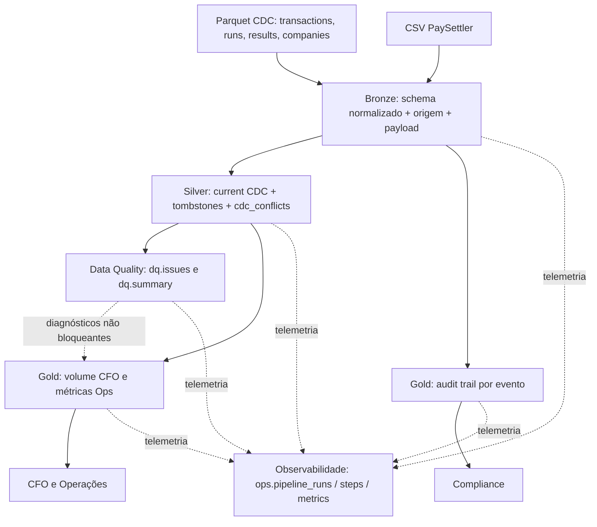

# Settlement Analytics — Marvin Data Engineering Challenge

Pipeline local em **Python 3.12+, DuckDB e Docker Compose** que transforma dados de transações, reconciliações, merchants e arquivos PaySettler em três produtos analíticos, com validações de qualidade, CDC e observabilidade persistente. Implementação orientada ao case de [reconciliação de liquidações](https://github.com/marvincomvc/data-engineer-challenge) e ao [glossário](https://github.com/marvincomvc/data-engineer-challenge/blob/main/docs/domain-glossary.md).

## Como rodar

### Pré-requisitos

- Docker e Docker Compose.
- Os arquivos originais em `docs/sample-data/` (dois batches de transações em Parquet, runs, results, cadastro e CSV `settlement*.csv`).
- `docker-compose.yml` com o serviço `pipeline` e os bind mounts `./scripts:/app/scripts`, `./docs/sample-data:/app/docs/sample-data:ro`, `./tests:/app/tests` e **`./data:/app/data`**. Configure os mounts adicionais já existentes sem removê-los.
- A imagem deve instalar as dependências do `pyproject.toml`, incluindo `duckdb`, `pytest` e `pytz` (necessário para leitura Python de `TIMESTAMPTZ` no verificador de idempotência). Se `pytz` ainda não estiver declarado, adicione-o às dependências antes do build.

```bash
mkdir -p data
docker compose up -d --build
docker compose ps
```

> O volume `./data:/app/data` persiste `data/marvin.duckdb` fora do container. Feche conexões de escrita da DuckDB UI/CLI antes de executar os pipelines para evitar locks.

### Pipeline completo

```bash
docker compose exec pipeline python scripts/run_pipeline.py \
  --input-dir /app/docs/sample-data \
  --db /app/data/marvin.duckdb \
  --with-gold \
  --gold-script scripts/gold.py
```

A execução materializa **Bronze → Silver → Data Quality → Gold**. Para apenas as três primeiras etapas, omita `--with-gold --gold-script scripts/gold.py`.

### Testes e idempotência

```bash
docker compose exec pipeline python -m pytest tests/ -v

docker compose exec pipeline python scripts/run_pipeline.py \
  --input-dir /app/docs/sample-data \
  --db /app/data/marvin.duckdb \
  --with-gold \
  --gold-script scripts/gold.py \
  --verify-idempotency
```

**Validação realizada em 12/10/2026:** 22 testes passaram; pipeline executado duas vezes com resultado `Idempotência OK: conteúdo lógico idêntico após reprocessamento`. A comparação automática de snapshots do CLI cobre tabelas **Bronze, Silver e `dq.issues`** (e contagem da view PaySettler); **não calcula hashes das tabelas Gold**. A Gold tem testes próprios de repetibilidade.

### Consultas úteis

```sql
SELECT * FROM gold.daily_financial_volume ORDER BY transaction_date, currency;
SELECT * FROM gold.daily_reconciliation_metrics ORDER BY reference_date;
SELECT * FROM gold.reconciliation_audit_trail LIMIT 20;
SELECT * FROM dq.summary ORDER BY issue_count DESC;
SELECT * FROM silver.cdc_conflicts ORDER BY source_table, business_key;
```

A UI do DuckDB é opcional (CLI: `duckdb /app/data/marvin.duckdb`, seguida de `LOAD ui; CALL start_ui_server();`, se a extensão estiver instalada). Se o Compose estiver configurado com `network_mode: host` e Docker Desktop suportar host networking, a UI ficará em `http://localhost:4213`. Uma conexão CLI/UI que mantenha o banco aberto para escrita pode impedir a execução Python simultânea.

### Resultado observado com o fixture original

| Componente | Registros / ocorrências |
|---|---:|
| `bronze.transactions` | 1.060 eventos |
| `bronze.reconciliation_runs` | 19 eventos |
| `bronze.reconciliation_results` | 837 eventos |
| `bronze.enterprise_company` | 70 eventos |
| `bronze.paysettler` | 510 linhas |
| `silver.transactions_current` | 992 ativos; 4 exclusões; 4 chaves ambíguas |
| `gold.daily_financial_volume` | 30 linhas |
| `gold.daily_reconciliation_metrics` | 9 linhas |
| `gold.reconciliation_audit_trail` | 837 eventos |

As contagens são evidências de uma execução local; não são valores contratuais para outros dados de entrada. Os datasets sintéticos de benchmark são processados em bancos separados, sem substituir os arquivos originais.

## Premissas e decisões

- **Bronze é imutável logicamente, não fisicamente append-only:** relê e substitui as tabelas em transação; preserva eventos `I/U/D`, payload original, origem do arquivo e timestamp de ingestão. Normalizações utilizam `TRY_CAST`; erros de conversão não devem ser interpretados como correções bem-sucedidas.
- **Silver representa o estado atual**, com `ROW_NUMBER()` por chave (`transaction_id` em transações; `id` nas outras fontes CDC), maior `_timestamp`, tombstones removidos. Empates no último timestamp com payloads distintos são excluídos da visão current e registrados em `silver.cdc_conflicts` — inclusive casos potencialmente equivalentes `I/U`.
- **PaySettler é um fluxo CSV sem envelope CDC:** `silver.paysettler_events` expõe o conteúdo Bronze sem inferir exclusões ou substituições.
- **Data Quality não altera fatos:** guarda divergências em `dq.issues` e agregações em `dq.summary`, com severidades diagnósticas. Problemas HIGH **não bloqueiam automaticamente** a Gold nesta versão.
- **Reconciliação:** as categorias vêm do serviço fonte, com tolerância de **R$ 0,01**, chave `transaction_id` e janela de datas `[reference_date - 7 dias, reference_date]` (UTC). As validações contra `transactions_current` são diagnósticos no **estado atual**, não provas de erro no snapshot histórico de cada run.
- **Anomalia comprovada na amostra:** a execução DQ identificou 808 ocorrências de `MERCHANT_MISMATCH`, 804 de `INTERNAL_AMOUNT_MISMATCH`, 601 de `TRANSACTION_OUTSIDE_WINDOW`, 5 de `RECON_DIFFERENCE_INCORRECT`, 5 de `RECON_RUN_MISSING`, 5 de `TRANSACTION_MISSING` e 4 chaves `CDC_AMBIGUOUS_LATEST`. Ocorrências podem se sobrepor; não somar como total de transações defeituosas. Um teste com dados regenerados (`--rows 10000 --days 30 --merchants 100 --seed 42 --clean`) produziu 9.479 matches completos, 521 ausências internas e 0 divergências de merchant/valor nos registros com match. Isto sugere diferenças entre os fixtures fornecidos e o comportamento do gerador, **sem provar a causa**.
- **CFO:** contabiliza somente transações internas `COMPLETED`, ativas e não ambíguas, agrupadas por **data UTC de criação + moeda**. Não significa volume efetivamente liquidado, caixa, receita líquida nem fotografia histórica “as-of”.
- **Operações:** usa a última execução `COMPLETED` por `reference_date` (`completed_at`, `started_at`, `id` decrescente) e publica métricas **reportadas**, não recomputadas contra transações internas.
- **Compliance:** conserva cada evento CDC de `bronze.reconciliation_results` enriquecido com o **estado atual** do run; não é reconstrução histórica completa de todos os campos do run.

- **Full refresh intencional:** o pipeline relê o conjunto completo de arquivos a cada execução para priorizar reprodutibilidade, simplicidade operacional e validação determinística do CDC. Idempotência neste desenho pressupõe um snapshot completo e estável das entradas. Ingestão incremental, checkpoints e recomputação seletiva são evoluções previstas, não funcionalidades implementadas.
- **Reconciliação independente fora do escopo:** este projeto consome os resultados do serviço de reconciliação e publica análises e diagnósticos sobre eles. Não recalcula categorias a partir de um join independente entre transações e PaySettler. A decisão evita apresentar como falhas históricas diferenças entre os fixtures originais e o estado corrente, sem evidências suficientes para reconstruir os snapshots de cada execução.

Mais detalhes: [Decisões arquiteturais](docs/ARCHITECTURE_DECISIONS.md) e [contratos Gold](docs/GOLD_CONTRACT_REVIEW.md).

## Visão geral da arquitetura



**Organização principal:**

```text
scripts/bronze_ingest.py      # ingestão e normalização
scripts/silver_cdc.py         # CDC e quarentena de empate
scripts/data_quality.py      # regras de consistência e issues
scripts/gold.py              # três produtos Gold
scripts/run_pipeline.py      # CLI, idempotência e instrumentação das etapas
scripts/pipeline_observability.py  # histórico persistente de execuções e métricas
tests/                       # 22 testes aprovados no ambiente validado
docs/sample-data/            # entradas originais, preservadas
docs/ARCHITECTURE_DECISIONS.md
docs/GOLD_CONTRACT_REVIEW.md
docs/OBSERVABILITY.md        # telemetria e limitações operacionais
docs/SCALABILITY_PLAN.md     # evolução para produção
docs/GOLD_ANALYTICAL_QUERIES.md
data/marvin.duckdb            # gerado localmente, não versionado
```

## Extensibilidade

**Segundo processador de liquidação com schema semelhante mas não idêntico: hoje não é plug-and-play.** O mapeamento de fontes e schemas está embutido no código, não em um catálogo declarativo. Caminho concreto para um novo `OtherSettler`:

1. Adicionar fixture CSV de teste em diretório controlado, sem misturá-lo com `settlement*.csv` do PaySettler.
2. Alterar `scripts/bronze_ingest.py`: estender `input_files()` para localizar a nova fonte e `SCHEMAS`/normalização para campos específicos (por exemplo `paid_value`, `processed_at`, `external_id`). Criar `bronze.othersettler` separado; **não** carregar registros de processadores diferentes no mesmo schema sem `processor_name`.
3. Alterar `scripts/silver_cdc.py`: criar `silver.othersettler_events` (ou generalizar um modelo de eventos com `processor_name`), mantendo sem CDC caso a nova fonte também seja snapshot/CSV sem `Op`.
4. Alterar `scripts/run_pipeline.py`: registrar a nova tabela nas listas de snapshot e no relatório de execução; generalizar `scripts/data_quality.py` com checks de campo obrigatório, duplicidade por processador/referência e integridade. Alterar `scripts/gold.py` **somente se** novos produtos passarem a consumir eventos externos — os três produtos atuais não fazem essa soma.
5. Estender `tests/test_bronze_ingest.py`, `tests/test_silver_cdc.py`, `tests/test_data_quality.py` e testes de integração; atualizar os contratos e exemplos.

**Impacto estimado na implementação atual:** pelo menos **3 arquivos Python** para ingestão/visibilidade no pipeline (`bronze_ingest.py`, `silver_cdc.py`, `run_pipeline.py`), **4 se incluirmos Data Quality**; mais **2–4 arquivos de teste/documentação**, conforme escopo. Ordem de grandeza: **~60–150 linhas de código/fixture/testes** para um adaptador simples. Isso é **estimativa**, não contagem medida. Se for exigido um modelo de liquidação unificado, o impacto é maior e incluirá a Gold. Uma versão mais extensível teria `config/processors.yml` com padrões de arquivos, colunas de origem, mapeamentos canônicos, timezone e regras de chave; **essa configuração ainda não existe**.

Rodar novamente: `pytest tests/ -v`, a CLI end-to-end e `--verify-idempotency`, mais testes de contract/schema drift e isolamento por processador. Validar que o PaySettler original não mudou.

## Limites do desenho

1. **Full refresh local:** Bronze/Silver/Gold recriam tabelas; não há ingestão incremental por offsets/checkpoints, particionamento persistente nem execução de backfill por `reference_date`. Em volumes da ordem de 5M/dia o custo e a janela de processamento deixam de ser previsíveis.
2. **CDC sem ordem total:** `_timestamp` sozinho não resolve atualizações concorrentes com timestamps iguais; chaves empatadas são quarentenadas. Produção exigiria LSN/sequence de origem, snapshot consistente e regras de resolução auditáveis.
3. **Auditoria histórica e governança incompletas:** `gold.reconciliation_audit_trail` contém histórico de eventos dos resultados, mas dados do run vêm do estado atual; não há trilha “as-of” imutável por execução nem controle de acesso/retention legal formalizado. Também não há gate automático impedindo publicação de métricas de origem pouco confiável.

## O que faria diferente em produção

Este case simplifica deliberadamente o ambiente: arquivos locais no lugar de CDC/ingestão incremental de PostgreSQL; DuckDB embedded em arquivo único; snapshots transacionais; execução CLI manual; sem infraestrutura de scheduler, alertas ou controle de acesso por consumidor.

Para produção eu adicionaria **extração CDC com offset/LSN e armazenamento versionado** (Parquet/Delta/Iceberg com idempotência por lote), **processamento incremental por partição/`reference_date` e política de backfill**, **contratos por processador com isolamento e `processor_name` obrigatório**, e **gates de DQ** (por exemplo, bloquear publicação financeira se a taxa de merchant mismatch exceder limiar acordado). Orquestração com retries, métricas de frescor/latência e rastreamento por `run_id`, além de RBAC e auditoria imutável para Compliance. Para a projeção de ~5M transações/dia, faria benchmark de memória/latência e avaliaria engine/armazenamento distribuído antes de ampliar o desenho local.

**Troubleshooting (dashboards sem dados desde sexta-feira):** começar por `ops.pipeline_runs` e `ops.pipeline_steps` (última execução bem-sucedida, etapa falha, duração e erro), e então verificar disponibilidade e horários dos arquivos, status do container e logs da CLI, frescor das tabelas Bronze/Silver/Gold, última `reference_date` publicada, `dq.summary`, contagem por fonte/run e presença de locks/erros de commit. Comparar números da fonte com Bronze e Silver para localizar a perda. Acionar equipe dona da fonte se faltar arquivo/CDC; plataforma se houver falha de infraestrutura; time de reconciliação se houver categorias ou runs inesperados.

## Ferramentas de IA utilizadas

**ChatGPT (OpenAI):** apoio na discussão de arquitetura Bronze/Silver/Gold, desenho e geração inicial de scripts Python/SQL, testes, documentação, investigação de CDC ambíguo, resolução de dependências Docker/DuckDB e interpretação de relatórios de qualidade. O uso foi iterativo, com feedback de execuções reais e correções quando os primeiros scripts falharam (ex.: `TRIM(DOUBLE)`, conflitos CDC e dependência `pytz`).

**Validação humana:** inspeção dos dados e do glossário, execução dos scripts e dos 22 testes originalmente reportados, confirmação de idempotência em Docker, execução do benchmark sintético de 1 milhão de registros e decisões finais sobre limitações e resultados. Código sugerido por IA deve ser revisado antes do PR; os resultados descritos acima vieram das execuções locais, não apenas de suposições do assistente.

### Escalabilidade

A implementação atual utiliza processamento batch com full refresh,
adequado ao escopo do desafio técnico.

Para evoluir rumo a aproximadamente 5 milhões de transações por dia,
foi elaborado um plano de evolução contemplando ingestão incremental,
CDC, particionamento, processamento seletivo e escalabilidade horizontal.

Consulte [Plano de Escalabilidade](docs/SCALABILITY_PLAN.md).

## Benchmark de desempenho

Foi executado um teste local com dados **sintéticos gerados** pelo script `scripts/generate_sample_data.py` e parâmetro `--rows 1000000`. O benchmark utilizou um banco DuckDB separado dos fixtures originais. O valor de 1 milhão descreve o **parâmetro de geração / volume de referência**, não uma contagem auditada de todas as tabelas — a quantidade efetiva varia conforme a fonte e as regras CDC.

**Resultado observado (pipeline completo, quatro etapas com status `SUCCESS`):**

| Etapa | Duração medida (`ops.pipeline_steps`) | Participação |
|---|---:|---:|
| Bronze | 41,70 s | 54,4% |
| Silver | 27,09 s | 35,3% |
| Data Quality | 2,05 s | 2,7% |
| Gold | 5,84 s | 7,6% |
| **Soma das etapas** | **76,68 s** | **100%** |

A taxa **indicativa** foi de aproximadamente **13 mil registros de referência por segundo** (`1.000.000 / 76,68`). Ela não equivale a throughput de linhas físicas totais: o pipeline processa várias fontes e as quatro etapas são sequenciais. Os **76,68 segundos são a soma das durações registradas por etapa**, e não uma medição externa de ponta a ponta, que também pode incluir inicialização e overhead do CLI. Bronze e Silver representaram aproximadamente **89,7%** da duração medida, sendo os primeiros candidatos a profiling e otimização.

### Reproduzir o benchmark

Gerar os dados localmente (fora do banco dos fixtures):

```bash
mkdir -p data/benchmark_1m
python scripts/generate_sample_data.py \
  --rows 1000000 \
  --days 30 \
  --merchants 500 \
  --seed 42 \
  --clean \
  --out data/benchmark_1m
```

A ingestão Bronze contempla a busca de `settlement_*.csv` no subdiretório `paysettler/`, quando disponível, com fallback para os arquivos da raiz. **Não copie os arquivos diários para a raiz sem verificar os padrões de descoberta**, para não duplicar os dados PaySettler.

```bash
/usr/bin/time -v docker compose exec -T pipeline \
  python scripts/run_pipeline.py \
  --input-dir /app/data/benchmark_1m \
  --db /app/data/benchmark_1m.duckdb \
  --with-gold \
  --gold-script scripts/gold.py
```

> O mount `./data:/app/data` precisa estar ativo. O comando `/usr/bin/time -v` executado no host mede o processo Docker CLI; seu campo de memória (`Maximum resident set size`) **não representa, necessariamente, a memória do processo Python no container**. Para medi-la, usar `docker stats` durante a execução e registrar o hardware, limites de memória, versão DuckDB e tamanho do banco.

Consultar a duração de cada etapa no banco **`data/benchmark_1m.duckdb`**:

```sql
SELECT step_name, duration_seconds, status
FROM ops.pipeline_steps
ORDER BY started_at;
```

Conferir os volumes efetivos de cada fonte e produto antes de tirar conclusões de throughput:

```sql
SELECT 'bronze.transactions' AS table_name, COUNT(*) AS row_count FROM bronze.transactions
UNION ALL SELECT 'bronze.reconciliation_results', COUNT(*) FROM bronze.reconciliation_results
UNION ALL SELECT 'bronze.paysettler', COUNT(*) FROM bronze.paysettler
UNION ALL SELECT 'silver.transactions_current', COUNT(*) FROM silver.transactions_current
UNION ALL SELECT 'gold.reconciliation_audit_trail', COUNT(*) FROM gold.reconciliation_audit_trail;
```

### Baseline menor e interpretação

Em outro teste com dados sintéticos (`--rows 10000 --days 30 --merchants 100 --seed 42 --clean`), observaram-se **9.479 transações internas**, **10.000 resultados de reconciliação**, **9.524 eventos PaySettler** e **10.000 linhas em `gold.reconciliation_audit_trail`**. O tempo externo medido com `/usr/bin/time -v` foi **3,41 s**. Como esse valor é um **wall-clock externo**, não deve ser comparado diretamente à soma das durações das etapas no teste de 1 milhão para afirmar ganho de throughput ou fator de escala.

O benchmark de 1 milhão **não demonstra sozinho** capacidade sustentada para milhões de transações por dia, crescimento histórico de anos, tolerância a falhas ou uso de memória dentro de um limite específico. Essas afirmações exigiriam contagens verificadas, medição do processo no container, execução contínua, cenários com dados sujos e testes de recuperação. O desenho atual continua **full refresh**, e a evolução para incremental deve ser considerada conforme o SLA, a retenção e o volume histórico real.

### Exemplos de consultas analíticas

Os produtos Gold disponibilizam métricas para CFO, Operações e Compliance.

Consulte [Exemplos de consultas SQL](docs/GOLD_ANALYTICAL_QUERIES.md).


## Observabilidade e monitoramento

O CLI grava **telemetria persistente** no schema `ops` do mesmo DuckDB, permitindo investigar quando o pipeline rodou, em qual etapa falhou e quantos registros foram processados. A coleta é automática nas execuções do `run_pipeline.py` (pode ser desabilitada com `--no-observability`).

| Tabela | Granularidade | Conteúdo |
|---|---|---|
| `ops.pipeline_runs` | Uma linha por invocação | `run_id`, início/fim, duração total, `RUNNING`/`SUCCESS`/`FAILED` e erro |
| `ops.pipeline_steps` | Uma linha por etapa e tentativa | Status, duração, erro, número da tentativa |
| `ops.pipeline_metrics` | Uma linha por métrica e tentativa | Volumetria e contagens informadas pelas etapas |

Após executar o pipeline, consulte:

```sql
-- Últimas execuções
SELECT run_id, started_at, finished_at, duration_seconds, status, error_message
FROM ops.pipeline_runs
ORDER BY started_at DESC
LIMIT 20;

-- Desempenho por etapa
SELECT step_name, COUNT(*) AS executions,
       ROUND(AVG(duration_seconds), 2) AS avg_seconds,
       ROUND(MAX(duration_seconds), 2) AS max_seconds
FROM ops.pipeline_steps
WHERE status = 'SUCCESS'
GROUP BY step_name
ORDER BY avg_seconds DESC;

-- Falhas registradas
SELECT run_id, step_name, attempt, started_at, error_message
FROM ops.pipeline_steps
WHERE status = 'FAILED'
ORDER BY started_at DESC;

-- Volumetria por execução
SELECT run_id, step_name, attempt, metric_name, metric_value
FROM ops.pipeline_metrics
ORDER BY run_id DESC, step_name, metric_name;
```

O teste `--verify-idempotency` registra as duas tentativas em `ops`, mas exclui a telemetria volátil da comparação lógica. **Limitações:** uma interrupção abrupta pode deixar a execução em `RUNNING`; não há alertas automáticos ou SLA de freshness; a telemetria depende do mesmo arquivo DuckDB e sofre suas restrições de escrita concorrente. Consulte [Observabilidade persistente](docs/OBSERVABILITY.md) para detalhes e recomendações de produção.


## Documentos adicionais

- [Decisões arquiteturais e trade-offs](docs/ARCHITECTURE_DECISIONS.md)
- [Revisão dos contratos Gold e queries por consumidor](docs/GOLD_CONTRACT_REVIEW.md)
- [Consultas analíticas de exemplo](docs/GOLD_ANALYTICAL_QUERIES.md)
- [Observabilidade persistente](docs/OBSERVABILITY.md)
- [Plano de escalabilidade](docs/SCALABILITY_PLAN.md)
- [Glossário do desafio](docs/domain-glossary.md)
