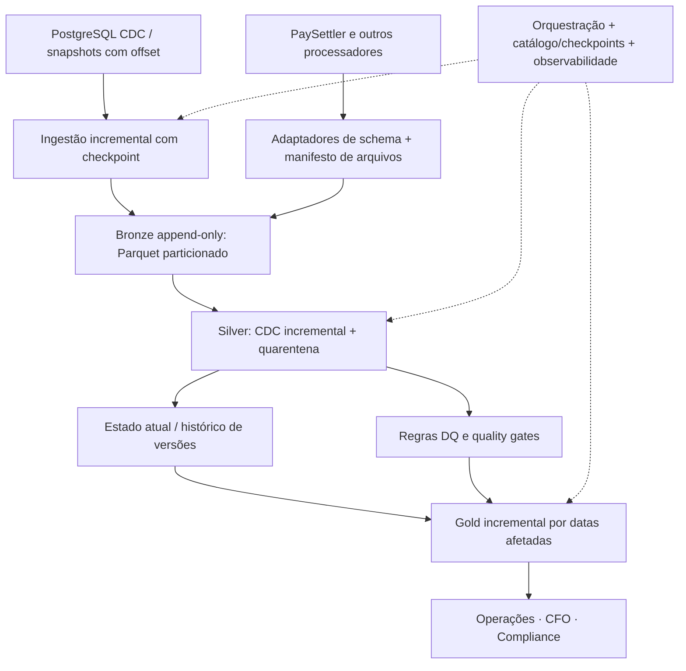

# Plano de escalabilidade — Settlement Analytics

**Escopo:** evolução proposta para até **5 milhões de transações por dia** (~1,825 bilhão por ano, considerando 365 dias), mantendo reconciliação diária, métricas financeiras e rastreabilidade para Compliance.

**Status:** documento de desenho; **as melhorias descritas aqui não foram implementadas nem testadas em escala**. A implementação atual é local, com Python 3.12, DuckDB, Docker Compose e filesystem. O cenário de 5 milhões/dia é uma meta de capacidade, não uma medição do pipeline atual.

## 1. Situação atual e principal gargalo

O projeto executa sequencialmente:

```text
Parquet/CSV → Bronze (full refresh) → Silver (CDC/current) → DQ → Gold
                                      ↓
                                DuckDB local
```

Cada execução relê as fontes e reconstrói as tabelas. Isso simplifica idempotência e reprodução do exercício, mas, com crescimento contínuo, o custo depende do **histórico acumulado**, não apenas dos dados novos. Em particular:

- A Bronze recria tabelas em vez de fazer ingestão incremental por arquivo/posição.
- A Silver calcula a versão mais recente por chave sobre o conjunto disponível; janelas e ordenações globais ficam caras conforme o histórico cresce.
- DQ e Gold são recalculadas integralmente.
- DuckDB roda em um único nó e o arquivo `.duckdb` demanda coordenação de escrita; o Docker Compose atual não implementa scheduler, checkpoints ou commits entre estágios.

O fluxo atual passou nos testes funcionais e no reprocessamento idempotente dos dados de exemplo. **Isso não é benchmark de throughput ou SLA**.

## 2. Dimensionamento e hipóteses

| Indicador | Cálculo / hipótese | Ordem de grandeza |
|---|---|---:|
| Transações por dia | Cenário solicitado | 5.000.000 |
| Transações por ano | 5.000.000 × 365 | 1.825.000.000 |
| Média de entrada | 5.000.000 / 86.400 s | ~58 transações/s |
| Pico de 10× (hipótese para planejar testes) | 58 × 10 | ~580 transações/s |
| Dados brutos a 0,5–2 KiB por evento (**ilustração**, antes de compressão) | 5 milhões × 0,5–2 KiB | ~2,4–9,5 GiB/dia |

Esses números **não são uma medição dos Parquets fornecidos**. Dimensionamento real deve considerar proporção de eventos `U`/`D`, quantidade de processadores, retenção, reprocessamentos, tamanho efetivo em Parquet, índices/metadados, e crescimento de `reconciliation_results` e do histórico. Uma média de 58/s não substitui testes de pico, nem diz se o SLA de publicação diária será cumprido.

## 3. Arquitetura evolutiva recomendada



### 3.1 Bronze incremental e armazenamento

1. Para tabelas internas, consumir CDC com **ordem autoritativa** do banco (`LSN`, sequência equivalente e identidade da transação de origem), em vez de depender somente de `_timestamp`.
2. Para arquivos de processador, registrar manifesto com `processor`, `file_id`, checksum, período de referência, horário de recebimento e estado da ingestão. Um mesmo arquivo reenviado não deve gerar duplicações.
3. Gravar eventos em **Parquet append-only**, preferencialmente em armazenamento de objetos em produção. Particionar por data de ingestão e fonte (`ingestion_date`, `source_system`); usar a data de negócio como metadado/filtro quando conveniente, **sem depender apenas dela** para localizar eventos atrasados.
4. Preservar payload original e metadados (`batch_id`, `source_file`, `ingested_at`, `source_offset`); aplicar esquema canônico versionado e registrar colunas novas/incompatíveis como eventos de validação.
5. Compactar pequenos arquivos periodicamente e adotar política de retenção/arquivamento; evitar partições por `transaction_id` (cardinalidade alta).

### 3.2 Silver — CDC incremental e deletes

- Manter uma **tabela de estado atual por chave de negócio**, juntamente com um histórico imutável de eventos/versões.
- Processar apenas offsets ainda não confirmados e aplicar `MERGE`/upsert por chave usando a sequência CDC como critério principal; o maior timestamp, sozinho, não é ordem total confiável.
- `D` vira **tombstone** e remove a chave do estado atual sem apagar o evento da trilha de auditoria.
- Empates sem ordem verificável continuam em `cdc_conflicts`/quarentena, com alertas, em vez de escolher um estado arbitrário.
- Guardar o último offset **confirmado após commit**. Reprocessar o mesmo lote deve produzir o mesmo estado; um lote falho não pode avançar o checkpoint.
- Para corrigir eventos antigos, suportar replay a partir de checkpoint/snapshot válido e recomputação das chaves afetadas.

### 3.3 Gold — recálculo seletivo

- **CFO:** atualizar somente datas de transação e moedas impactadas por inserts/updates/deletes; mudanças retroativas exigem recomputar a data anterior e a nova quando houver alteração de data.
- **Operações:** atualizar a `reference_date` impactada após chegada, conclusão ou reprocessamento de uma execução de reconciliação; selecionar explicitamente a última execução válida por data e manter contagens por categoria.
- **Compliance:** acrescentar eventos históricos com identificadores de origem e ligação às versões de execução; não depender apenas de `reconciliation_runs_current` para reconstrução *as-of*.
- Registrar `publication_version`, `input_watermark` e horário de fechamento de cada partição agregada para permitir rastreabilidade, backfill e publicação consistente.

### 3.4 Janelas atrasadas e backfill

Definir uma janela operacional de reprocessamento **parametrizável**, por exemplo os últimos 7–14 dias como ponto inicial a validar com o negócio — não confundir essa política com a janela de 7 dias usada pela reconciliação. Eventos fora da janela disparam backfill direcionado das partições/datas impactadas, com motivo e aprovação quando alteram números já publicados. Datas fechadas devem ter versão e reconciliação do ajuste.

## 4. Política de qualidade e consistência de publicação

A implementação atual registra problemas de DQ, mas não bloqueia a Gold. Em produção:

- **Bloqueio de publicação:** fonte obrigatória ausente, schema incompatível, checkpoint inconsistente, duplicação de chave após CDC, ou integridade financeira abaixo de um limiar definido pelo negócio.
- **Quarentena + publicação condicionada:** registros individuais ambíguos, mantendo seu impacto quantificado; consumidores enxergam o status `COMPLETE`, `PARTIAL` ou `BLOCKED` por data/produto.
- **Alertas sem bloqueio:** anomalias não críticas, com owner, severidade e prazo para investigação.

Os dados de exemplo apresentaram altas divergências entre fontes; a versão de produção não deve tratar um indicador derivado do serviço de reconciliação como se tivesse sido validado independentemente. Definir quais relatórios podem ser publicados como *reported* versus *verified*.

Para evitar misturar gerações de tabelas, publicar uma **versão lógica única**: construir Bronze/Silver/Gold e controles para `batch_id`, validar, e só então tornar o `publication_version` visível aos consumidores. Uma transação isolada por script, como hoje, não garante essa consistência ponta a ponta.

## 5. Quando manter DuckDB e quando distribuir

**Manter DuckDB** se o pipeline continuar majoritariamente em lote, com partições Parquet bem organizadas, recálculos seletivos, um escritor coordenado e recursos suficientes de CPU, RAM e disco para cumprir o SLA. Ele pode ser eficiente em volumes grandes mesmo em um único nó; **5 milhões/dia não exige automaticamente Spark**.

**Considerar processamento distribuído (por exemplo Spark/Databricks)** quando benchmarks mostrarem que não é possível cumprir as janelas de processamento e backfill com um único nó de custo razoável, especialmente com múltiplos anos de histórico, joins/shuffles amplos, alto paralelismo e reprocessamentos simultâneos. Nesse cenário, usar tabela transacional em lakehouse (Delta/Iceberg, conforme plataforma), CDC incremental com `MERGE`, isolamento de workloads e orquestração de jobs.

**Critérios de decisão medidos**, não somente número de linhas:

| Dimensão | Medida para decidir |
|---|---|
| SLA | Tempo entre recebimento do arquivo/offset e publicação Gold; p95 e pior caso |
| Backfill | Tempo para reprocessar 1, 7 e 30 dias de eventos |
| Recursos | Pico de RAM, spill para disco, CPU, I/O, espaço temporário |
| Confiabilidade | Taxa de falhas/retries e tempo de recuperação sem inconsistência |
| Concorrência | Necessidade de processar várias fontes e publicar simultaneamente |
| Custo | Custo por milhão de eventos e por execução, incluindo armazenamento e operação |

Evoluir primeiro o **padrão de processamento incremental**; trocar DuckDB por Spark sem mudar o full refresh não resolve a causa principal do crescimento de custo.

## 6. Plano de migração por fases

| Fase | Mudança concreta | Critério de aceite |
|---|---|---|
| 0 — Baseline | Gerar datasets com 1M, 5M e 10M eventos; coletar recursos, tempos e volumes | Métricas repetíveis, ambiente documentado |
| 1 — Bronze | Manifesto de arquivos/offsets e Parquet append-only particionado | Mesmo lote não duplica; arquivos atrasados detectados |
| 2 — Silver | Estado atual incremental, tombstones, replay e checkpoint atômico | Mesma saída que full refresh no conjunto de referência |
| 3 — Gold/DQ | Recalcular apenas partições afetadas e aplicar quality gates | Métricas equivalentes e publicação atômica por versão |
| 4 — Operação | Scheduler, backfills, alertas de SLA e retenção | Recuperação e operação validadas em cenários de falha |
| 5 — Distribuição, se necessária | Migrar transformações que excedem capacidade de nó único | SLA e custo melhores em benchmark representativo |

## 7. Testes de carga e falha propostos

Além dos 22 testes funcionais aprovados no projeto atual:

- **Carga:** 5M eventos/dia, picos de 10× e datasets com 1 ano de histórico; comparar full refresh e incremental.
- **CDC:** updates duplicados, deletes repetidos, evento fora de ordem, atraso grande, conflito com mesma sequência e recuperação após falha antes/depois do checkpoint.
- **Reprocessamento:** executar novamente o mesmo lote/arquivo e comparar estado atual e Gold por conteúdo e versão; validar correções retroativas.
- **Confiabilidade:** matar execução durante ingestão, atualização da Silver e publicação Gold; garantir que a versão anterior continue consultável.
- **Financeiro:** conciliar totais e contagens por `reference_date`, moeda e processador com critérios de arredondamento e registros de exceção.

**Metas propostas para negociação com o negócio (não requisitos confirmados):** definição de horário-limite diário, tolerância máxima de dados atrasados, RPO/RTO, retenção de auditoria e thresholds de DQ. O SLA final deve ser pactuado antes do sizing definitivo.

## 8. Limitações deliberadas da solução entregue

1. **Full refresh e arquivo DuckDB local:** não oferece checkpoints, ingestão incremental nem elasticidade horizontal.
2. **Sem ordem CDC autoritativa e auditoria as-of completa:** `_timestamp` pode empatar; algumas chaves vão para quarentena; histórico de runs no modelo de consumo não reconstrói integralmente todas as versões anteriores.
3. **Sem commit lógico ponta a ponta nem quality gates para Gold:** uma falha entre estágios pode deixar versões diferentes de dados e problemas HIGH não interrompem a publicação automaticamente.

Essas escolhas tornam a solução do take-home simples e reproduzível, mas não devem ser apresentadas como prontas para um ambiente financeiro de produção.

## Referências

- [Enunciado — Marvin Data Engineer Challenge](https://github.com/marvincomvc/data-engineer-challenge)
- [Glossário de domínio](https://github.com/marvincomvc/data-engineer-challenge/blob/main/docs/domain-glossary.md)
- [Documentação do DuckDB](https://duckdb.org/docs/stable/)

